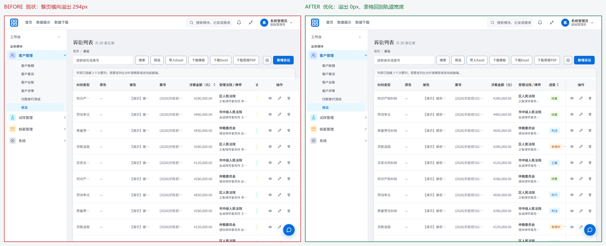
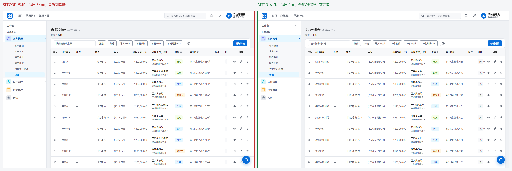
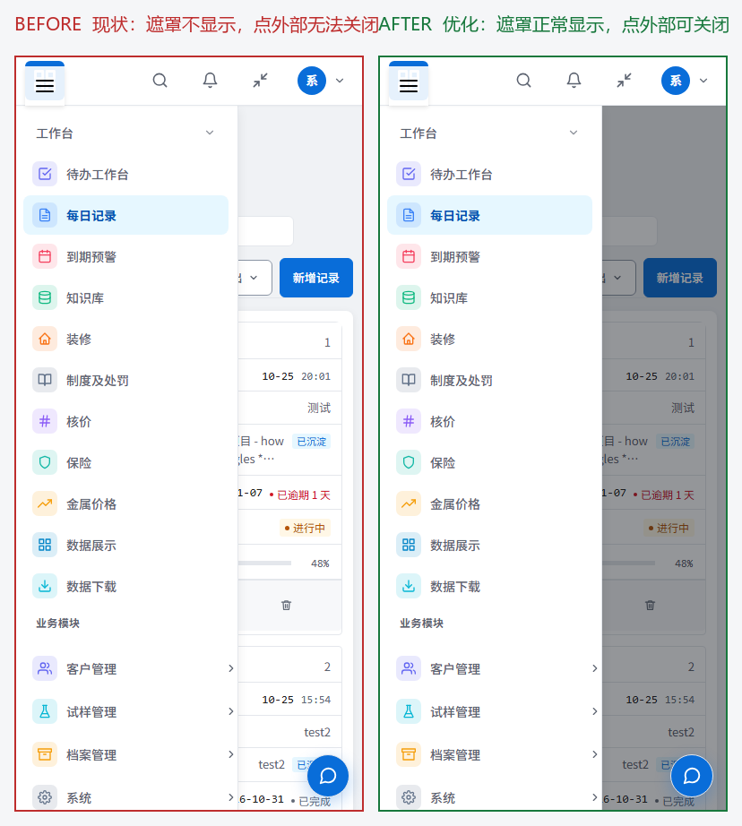
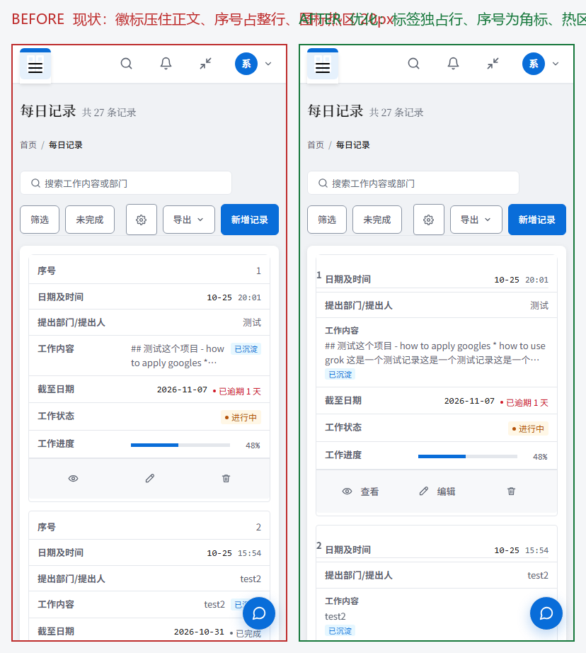

# UI / 交互 / 响应式审计报告

状态：审计完成，待排期整改（本次未改动任何业务代码）。
日期：2026-11-08。
审计对象：AI Daily Work Record，commit `826a2ef`（诉讼 Excel 导入 + 诉讼周报 PDF 导出）。
运行环境：`http://127.0.0.1:9000`（HTTP，`scripts\windows\project.ps1 restart -Port 9000`），Django 5.2.18 + Python 3.13.14，Chromium 152（Playwright 驱动）。
依据：真实浏览器渲染 + DOM 几何量测 + CSS 源码溯源 + 注入式 A/B 验证。

---

## 〇、审计方法与可复现性

### 取证方式

| 手段 | 说明 |
|---|---|
| 视口扫描 | 320 / 390 / 768 / 1024 / 1180 / 1440 / 1512 / 1600 / 1920 九档，每档量测 `documentElement.scrollWidth - clientWidth`、各列实际渲染宽度、触控热区尺寸、字号 |
| DOM 几何量测 | 每个元素取 `getBoundingClientRect()` 与 `getComputedStyle()`，识别横向越界元素、被裁剪祖先、低于 32px 的可点击热区、低于 12px 的文本 |
| 源码溯源 | 逐条回溯到 CSS 规则与模板行号，区分「设计意图」与「实际行为」 |
| A/B 注入验证 | 在同一张真实页面上注入优化样式（`add_style_tag`）后重新渲染，前后截图对照，验证建议确实有效 |

### 可复现脚本

审计脚本位于 `.ui-audit/`（未纳入版本管理，可按需保留或删除）：

| 文件 | 用途 |
|---|---|
| `.ui-audit/audit.py` | 九档视口扫描 + 截图 + `report.json` |
| `.ui-audit/laptop.py` | 1180px 死区专项取证 |
| `.ui-audit/ab.py` | 桌面端表格 A/B 对比渲染 |
| `.ui-audit/mobile.py` | 小屏卡片模式与抽屉遮罩 A/B 对比渲染 |
| `.ui-audit/measure.py` / `dbg.py` | 列宽实测与特异度溯源 |
| `.ui-audit/compose.py` | 拼接带标注的左右对比图 |

### 登录说明

审计需登录，审计期间曾临时重置 `admin` 账号口令。**该临时口令已于 2026-11-08 轮换为随机强口令并验证失效**，新凭据不落盘到仓库、不在本文档留存；`.ui-audit/` 取证脚本已改为从环境变量 `UI_AUDIT_PASSWORD` 读取，不再硬编码任何口令。

---

## 一、结论摘要

这套前端**设计系统本身是健康的**：7 套分层 CSS、完整令牌体系、卷宗式统一外壳、台账表格语义（`.table-ledger` / `.table--fixed` / `.col-optional`）、表头吸附、卡片模式兜底、暗色主题、`prefers-reduced-motion` 适配、完整的打印样式，无障碍属性同步准确。

问题集中在**一个被打破的假设**上：`app.css:2012` 的注释写明「宽表列宽已收敛到 1142px 单轨容器；横向滚动只留给 <961px 窄屏的原有规则」。该假设对早期表格成立，但新引入的诉讼表格（`min-width: 1200px`）没有遵守，于是 ≥961px 时横向滚动被关闭、表格又宽于容器 → **整页横向滚动**。

由于 `.table-head-sticky` 由 `table-tools.js` 自动挂到**每一张有 thead 的表**，这个 `overflow: visible` 是全局生效的。**新增的、带固定 min-width 的表格都会立刻掉进同一个坑**，属于会持续复发的结构性缺陷，而非一次性 bug。

### 问题清单

| 编号 | 级别 | 问题 | 影响面 |
|---|---|---|---|
| P0-1 | P0 | 桌面端台账撑破页面轨道，整页横向滚动 | 961–1498px 全部宽度，4 个列表页 |
| P0-2 | P0 | 移动端抽屉遮罩被 `hidden` 属性压掉，点外部无法关闭 | Chrome / Edge 全部用户 |
| P1-1 | P1 | 列预算按 1200px 设计，全站轨道最宽仅 1142px，关键列系统性截断 | 1440px 及以下 |
| P1-2 | P1 | 小屏卡片模式徽标压住正文 | ≤640px 全部卡片表 |
| P1-3 | P1 | `.col-optional` 在卡片模式下未被隐藏（特异度冲突），且提示条被同时隐藏 | ≤640px |
| P1-4 | P1 | 触控热区普遍低于 32px，徽标字号低至 11.2px | ≤640px |
| P1-5 | P1 | 三套断点各自为政，且按视口而非容器计算 | 全站 |
| P2-1 | P2 | 「已隐藏 N 个次要列」提示为手写常量，与实际列数不符（6 个列表页中 2 个不一致） | 4 个列表页 |
| P2-2 | P2 | 纠纷类型在表单是自由文本、在筛选器是下拉 | 诉讼模块全部录入 |
| P2-3 | P2 | 12 列中 3 列常年为空，白占轨道 | 诉讼列表 |
| P2-4 | P2 | 悬浮对话按钮遮挡卡片内容 | ≤640px |

### 溢出影响面实测

单位：px（`documentElement.scrollWidth - clientWidth`）

| 视口 | 诉讼 | 每日记录 | 装修 | 客户账期 |
|---|---|---|---|---|
| 1024×768 | **450** | **360** | **392** | **330** |
| 1280×720 | **194** | **104** | **136** | **74** |
| 1366×768 | **108** | 18 | 50 | OK |
| 1440×900 | **34** | OK | OK | OK |
| 1512×982 | OK | OK | OK | OK |
| 1600×900 | OK | OK | OK | OK |
| 1920×1080 | OK | OK | OK | OK |

1366×768 是国内保有量最高的笔记本分辨率。

---

## 二、P0 级问题

### P0-1　桌面端台账撑破页面轨道，整页横向滚动

#### 现象

在 961–1498px 之间的任何宽度，列表页整体横向滚动，拖动的是**整个页面**——固定侧栏与顶栏一起位移。



> 现状截图里「进度」列被压成一条只剩色条、没有文字的竖线，状态信息在 1366px 笔记本上完全不可读。

#### 证据

实测 `htmlOverflowX: visible`，且所有越界元素的 `clippedBy` 均为 `null`——**没有任何祖先裁剪**，溢出直接外泄到文档。

| 页面 | 视口 | 文档宽 | 容器宽 | 表格宽 | 溢出 |
|---|---|---|---|---|---|
| 诉讼 | 1440 | 1474 | 1142 | 1200 | 34 |
| 诉讼 | 1180 | 1474 | 882 | 1200 | 294 |
| 每日记录 | 1180 | 1384 | 882 | 1110 | 204 |
| 装修 | 1180 | 1416 | 882 | 1142 | 236 |

同一张表格在 768px 时 `parentOverflowX = auto`（内部滚动，不外泄），在 1180px 时变成 `visible`（外泄）——断点行为在 961px 处翻转。

#### 根因

三处代码互相配合：

1. `records/templates/records/complaint_list.html:191`

   ```css
   .table { min-width: 1200px; }
   ```

   选择器是 `.table` 而非 `.table--fixed`，会命中页内所有 `.table`。

2. `static/css/daily-record.css:34` → `min-width: 1110px`

3. `static/css/app.css:2014-2019` 与 `2045-2049` —— 为实现表头吸附，≥961px 时关闭了横向滚动容器：

   ```css
   @media (min-width: 961px) {
     .table-responsive:has(.table-head-sticky) {
       max-height: none;
       overflow: visible;   /* ← 横向滚动容器在此被关闭 */
     }
   }
   ```

#### 为什么是结构性问题

`.table-head-sticky` 由 `table-tools.js` 自动给每张有 thead 的表加上，因此上述 `overflow: visible` 全局生效。任何新增的、写死 `min-width` 的表格都会立刻重现该缺陷。

#### 建议

**第一步（CSS，改动最小）** —— 让宽表回到轨道内：

```css
@media (min-width: 961px) {
  .table-responsive table { min-width: 0 !important; width: 100% !important; }
}
```

**第二步（模板）** —— 去掉 `complaint_list.html:191` 的 `min-width: 1200px`，改用 px 列保底：

```css
.table-ledger > thead > tr > th:nth-child(2)  { width: 106px; } /* 纠纷类型：不截断 */
.table-ledger > thead > tr > th:nth-child(5)  { width: 140px; } /* 案号 */
.table-ledger > thead > tr > th:nth-child(6)  { width: 106px; } /* 金额 */
.table-ledger > thead > tr > th:nth-child(8)  { width: 80px; }  /* 进度 */
.table-ledger > thead > tr > th:nth-child(12) { width: 116px; } /* 操作 */
```

**第三步（根治）** —— 把列降级从「视口断点 + 硬编码 `.col-optional`」改为**容器查询 + 列优先级**：

```css
.table-container { container-type: inline-size; }
@container (max-width: 900px) { [data-priority="3"] { display: none; } }
```

这样新增表格只需标注列优先级即可自动获得正确降级行为，不会再出现「新表格忘记收进 1142px 轨道」。

**产品层配套** —— 把 `原告 / 被告` 合并为一列「当事人」（公司通常恒为原告）、`详细进度` 下沉到详情页只留摘要，可直接为「案号 / 金额 / 进度」腾出 200px 以上。

#### 验证结果

注入上述修复后实测：**1180px 溢出 294px → 0px；1440px 溢出 34px → 0px**，12 列一个不少，`纠纷类型 / 涉案金额 / 进度` 全部完整可读。



---

### P0-2　移动端抽屉遮罩被 `hidden` 属性压掉

#### 现象

390px 下点击汉堡按钮打开侧栏抽屉后：

- 抽屉**没有遮罩**，内容区没有被压暗，与抽屉之间没有视觉分隔
- **点击抽屉外部无法关闭**（关闭方式只剩汉堡按钮、Esc、点菜单项三种）

#### 证据

`records/templates/records/base.html:53`

```html
<div class="sidebar-scrim" id="sidebarScrim" hidden></div>
```

`static/css/components.css:303` 已有对应规则：

```css
body.sidebar-open .sidebar-scrim { display: block; }
```

但实测：

| 检测项 | 结果 |
|---|---|
| 抽屉打开时遮罩 `display` | **`none`** |
| 移除 `hidden` 属性后 `display` | `block` ✅ |
| 作者样式 `style="display:block"` 加在 `[hidden]` 元素上 | 仍计算为 **`none`** |
| 手动解除 `hidden` 后点击遮罩 | 抽屉正常关闭 ✅ |

#### 根因

Chrome 的 UA 样式表对 `[hidden]` 使用了 **`!important`**，作者层的 `display: block` 压不过它。

`static/js/shell.js:28-30` 的遮罩点击处理器**逻辑本身是正确的**，只是遮罩永远不显示，点击穿透到了内容区。

该缺陷仅在 Chromium 系（Chrome / Edge）出现，Firefox 无此问题——典型的浏览器特异性 bug。

#### 建议

二选一：

```css
/* 方案 A：CSS 层加 !important（改动最小） */
body.sidebar-open .sidebar-scrim { display: block !important; }
```

或直接去掉 `base.html:53` 的 `hidden` 属性，改由 CSS 独占控制显示（属性与样式不再双源）。



---

## 三、P1 级问题

### P1-1　列预算按 1200px 设计，全站轨道最宽仅 1142px

`complaint_list.html:190-203` 的注释称「列预算（合计 100%）」，但这套百分比是在 **1200px** 前提下算的：

- 1440px 视口 → 轨道 1142px（1440 − 250 侧栏 − 48 内边距）
- 1180px 视口 → 轨道 **882px**

1180px 下实测各列实际渲染宽度：

| 列 | 纠纷类型 | 原告 | 被告 | 案号 | 金额 | 法院/律师 | 进度 | 操作 |
|---|---|---|---|---|---|---|---|---|
| 宽度(px) | 93 | 77 | 130 | 144 | 109 | 132 | 83 | 114 |

合计 **882px**，与轨道分毫不差——即预算已被 1200px 的 min-width 顶爆后再压缩，**每一列都在硬扛**。

`纠纷类型` 列 93px、左右 padding 各 14px、13px 字号 → 内容区仅 65px，而「知识产权纠纷」6 个汉字需 78px，必然截断为「知识产权…」。1440px 下同样如此。

**建议**：见 P0-1「第二步 / 第三步」。核心是让列预算基于**实际轨道宽度**而非某个假设值。

---

### P1-2　小屏卡片模式：徽标压住正文

390px 的每日记录卡片中，「工作内容」正文与「已完成」徽标挤在同一 flex 行，正文换行后从徽标下方穿过：

```
工作内容   ## 测试这个项目 - how to apply google's [已完成]
           to apply google's⋯          ← 第二行从徽标下方穿过
```

**根因**：`static/css/components.css:112` 的 `.table--cards td { display: flex; justify-content: space-between }`，长文本作为 flex item 不会收缩到徽标左侧。

**建议**：长文本单元格改为块级布局，标签独占一行：

```css
@media (max-width: 640px) {
  .table--cards td[data-label="工作内容"],
  .table--cards td[data-label="详细进度"],
  .table--cards td[data-label="受理法院 / 律师"] { display: block !important; }
  .table--cards td[data-label="工作内容"]::before {
    display: block !important; width: 100%; text-align: left; margin-bottom: 3px;
  }
}
```



---

### P1-3　`.col-optional` 在卡片模式下未被隐藏（特异度冲突）

`static/css/app.css:1341-1345`：

```css
@media (max-width: 1280px) {
  .col-optional { display: none; }
}
```

但 `static/css/components.css:112` 的 `.table--cards td { display: flex }` 特异度为 **(0,1,1)**，高于 `.col-optional` 的 **(0,1,0)**，因此在卡片模式下「次要列」照常渲染。

实测：390px 下 `序号`（`class="col-optional"`）的 `display` 计算值为 **`flex`**，而非 `none`。

同时 `static/css/components.css:157-160` 又在卡片模式下把「已隐藏 N 个次要列」提示条藏了——**提示声称隐藏了、实际没隐藏**，两处逻辑互相打架。

**建议**：

```css
@media (max-width: 640px) {
  .table--cards td.col-optional { display: none !important; }
}
```

---

### P1-4　触控热区偏小、字号下限偏低

实测（移动端）：

| 元素 | 实测尺寸 | 建议 |
|---|---|---|
| `button.kb-cat-caret`（知识库折叠箭头） | **20×26** | ≥44×44 |
| `a.kb-side-btn`（管理 / 新建） | **42×26** | ≥44 |
| `a.tag-item`（知识库标签） | 85×31 | ≥44 高 |
| 列表页操作图标 | ≈20×20 | ≥44 |
| `span.kb-chip` 字号 | **11.5px** | ≥12px |
| `span.status-badge.warning` 字号 | **11.2px** | ≥12px |

`static/css/app.css:1329` 已有「触屏下保证 48px 点击区域」的意图：

```css
.table:not(.table--cards) tbody tr { height: 48px; }
```

但该规则**显式排除了卡片模式**，图标按钮因此回落到 20px。

**建议**：卡片模式下为操作按钮单独设 44px 触控高度，并改为带文字标签（查看 / 编辑 / 删除），避免纯图标在触屏上语义不明：

```css
@media (max-width: 640px) {
  .table--cards td[data-label="操作"] :is(a, button) {
    min-height: 44px; padding: 0 14px; gap: 6px;
    display: inline-flex; align-items: center; white-space: nowrap;
  }
}
```

---

### P1-5　三套断点各自为政，且按视口而非容器计算

| 机制 | 位置 | 断点 |
|---|---|---|
| 解除文本截断 | `static/css/main.css:134` | ≤768px |
| 表格转卡片模式 | `static/css/components.css:91` | ≤640px |
| 隐藏次要列 | `static/css/app.css:1345` | ≤1280px |

三个问题：

1. **641–768px 是夹缝带**：截断已解除但表格仍是表格 → 列变宽 → 反而更容易溢出
2. **按视口而非容器**：侧栏占 250px，1281px 视口的实际轨道只有 1031px，但 `.col-optional` 不会隐藏 → 必然溢出
3. **全宽 / 限宽视图模式不参与计算**：`data-view-mode` 只改 `main#main` 的 max-width（1440px），列隐藏规则仍看视口 → 同一台机器切换视图模式表现不一致

实测（1600px 视口）：`full` 与 `limited` 两种模式下 `main` 宽度均为 1302px；`limited` 的 1440px 上限在 1600px 视口下不构成差异，**只有 ≥1740px 视口才体现差别**。

**建议**：统一到容器查询（见 P0-1「第三步」），或至少把三套断点收敛到 `components.css:287-291` 已声明的三档（960 / 640 / 1280）。

---

## 四、P2 级问题

### P2-1　提示文案与实际列数不符

`records/templates/records/complaint_list.html:112` 写死：

```html
<div class="hidden-cols-hint">窄屏已隐藏 3 个次要列；需要逐列比对时请横屏或改用桌面端。</div>
```

但该表只有 `序号`（line 115）与 `备注`（line 124）两列带 `col-optional`——**实际是 2 个**。文案是手写常量，不随模板列数变化而更新。

全站 6 个使用该提示条的列表页校验结果：

| 模板 | 提示文案 | 实际 `col-optional` 列数 | 一致性 |
|---|---|---|---|
| `complaint_list.html` | 3 | **2** | ✗ |
| `customer_ledger_list.html` | 4 | **5** | ✗ |
| `daily_record_list.html` | 1 | 1 | ✓ |
| `decoration_list.html` | 1 | 1 | ✓ |
| `customer_credit_list.html` | 2 | 2 | ✓ |
| `regulation_list.html` | 1 | 1 | ✓ |

6 个里 2 个不一致，且不一致方向相反（一个多报、一个少报）。这说明提示文案与模板列数之间**没有任何强制关联**——今天是手写数字，明天加一列而忘了改文案，系统仍会照常显示错误的数字。现有 4 个「一致」属于恰好对上了，不是机制保证。

**建议**：改为模板变量自动生成，或在 CI 中校验文案与 `col-optional` 数量一致。

### P2-2　纠纷类型在表单是自由文本、在筛选器是下拉

- `records/forms.py:404` → `dispute_type: forms.TextInput(attrs={'placeholder': '请输入纠纷类型'})`
- `records/templates/records/complaint_list.html:24-27` → 筛选器为 `<select>`，选项来自 `dispute_types`

同一字段两种输入方式。自由文本意味着「知识产权纠纷 / 知识产权纠纷 / 知识产权纠」会被视为三个不同分类，**导出统计与周报口径随录入习惯漂移**。这是数据模型级问题，不是样式问题。

**建议**：改为 `ChoiceField`，选项复用现有 `dispute_types` 集合；历史数据做一次归一。

### P2-3　12 列中 3 列常年为空

诉讼列表 12 列中，`原告`（20 条演示数据全部为 `—`）、`备注`、`附件` 三列几乎无内容。在 882px 的轨道上为常年空列让位，正是 P1-1 的直接成因。

**建议**：与 P0-1 的产品层配套一并处理（合并当事人列 / 下沉详情页）。

### P2-4　悬浮对话按钮遮挡卡片内容

390px 下位于右下角，直接压住卡片最后一行——知识库页压住「django」标签、每日记录页压住第二张卡片的「已完成」徽标。

**建议**：小屏收起为纯图标并为内容区预留 `padding-bottom`，或滚动时自动隐藏。

---

## 五、值得肯定的部分

| 项 | 说明 |
|---|---|
| 令牌体系 | `tokens.css` 统一语义色 / 间距 / 圆角 / 阴影，暗色主题零散落 |
| 统一外壳 | `page-shell.css` 的 3px 书脊、等宽 kicker、自动 01/02 编号分区，风格统一且有辨识度 |
| 表头吸附 | `position: sticky` 方案避免「每张表自带竖向滑块」 |
| 无障碍 | `aria-expanded` / `aria-pressed` / `aria-controls` / `aria-label` 同步准确；抽屉打开后 Esc 关闭并正确回落焦点；汉堡按钮实测 44×44 |
| 减弱动效 | `prefers-reduced-motion` 在 4 个 CSS 文件中均有兜底 |
| 打印样式 | 台账、评审单、周报均有专门的 `@media print` 规则 |
| 测试覆盖 | 全量 1192 个测试通过；`tests/visual/` 另有可视化回归脚本 |

---

## 六、整改清单（按优先级）

| 优先级 | 编号 | 改动点 | 主要文件 | 验证结果 |
|---|---|---|---|---|
| P0 | P0-1 | 去掉表格硬 `min-width`，改为列预算 + 容器查询 | `app.css` / `complaint_list.html` / `daily-record.css` | 溢出 294→0、34→0 |
| P0 | P0-2 | 遮罩 `!important` 或移除 `hidden` 属性 | `components.css` / `base.html` | 遮罩显示，点外部可关闭 |
| P1 | P1-1 | 列预算基于实际轨道宽度 | 各列表页 `extra_css` | 关键列完整可读 |
| P1 | P1-2 | 长文本单元格标签独占一行 | `components.css` | 徽标不再压字 |
| P1 | P1-3 | `.table--cards td.col-optional` 显式隐藏 | `components.css` | 次要列正确隐藏 |
| P1 | P1-4 | 操作按钮 44px + 文字标签；字号下限 12px | `components.css` | 热区 20→44px |
| P1 | P1-5 | 断点收敛到 960 / 640 / 1280 三档 | `components.css` / `app.css` | — |
| P2 | P2-1 | 提示文案改为模板变量自动生成 | 各列表页 | — |
| P2 | P2-2 | `dispute_type` 改 `ChoiceField` | `records/forms.py` | — |
| P2 | P2-3 | 合并当事人列 / 详细进度下沉 | `complaint_list.html` | — |
| P2 | P2-4 | 悬浮按钮小屏避让 | `app.css` | — |

### 回归验证清单

整改后建议重跑以下检查：

1. `python manage.py test`（全量 1192 个用例）
2. 视口扫描：320 / 390 / 768 / 1024 / 1366 / 1440 / 1600 / 1920，确认所有列表页 `overflowX == 0`
3. 抽屉遮罩：390px 下打开抽屉，断言 `#sidebarScrim` 计算 `display == 'block'`，且点击遮罩后 `body.classList` 不含 `sidebar-open`
4. 卡片模式：断言 `.table--cards td.col-optional` 计算 `display == 'none'`
5. 触控热区：断言移动端所有可点击元素 `width >= 32 && height >= 32`
6. 新增列表页须带列预算，并在 `tests/visual/shot-cases.json` 补一条断言

---

## 七、遗留事项

1. **临时口令（已闭环）**：审计期间曾重置 `admin` 口令，已于 2026-11-08 用 `python manage.py rotate_default_passwords --legacy-password <审计临时口令>` 轮换为随机强口令，旧口令经 `check_password` 验证已失效。**命令勘误**：不带 `--legacy-password` 的 `--force` 只覆盖 `rbac_*` 验收账号与仓库历史公开过的默认口令，**不会命中本次临时口令**，原建议命令无效。
2. **审计产物**：`.ui-audit/` 为临时取证目录（截图 + 脚本 + `report.json`），未纳入版本管理，可自行保留或删除。本文档引用的对比图已归档至 `docs/images/ui-audit-20261108/`。
